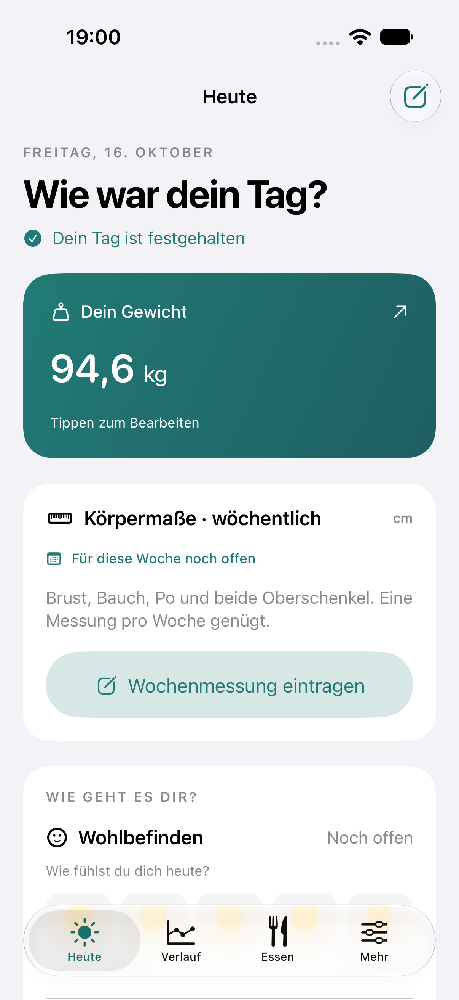
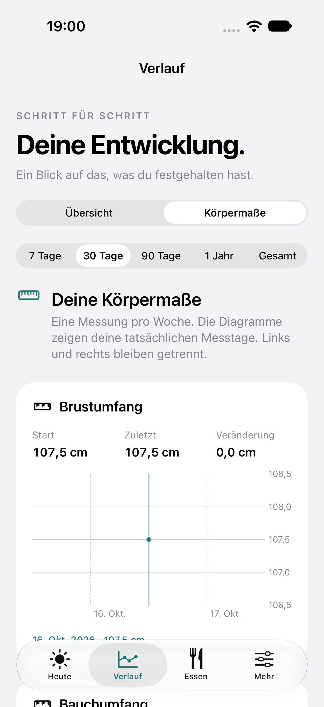
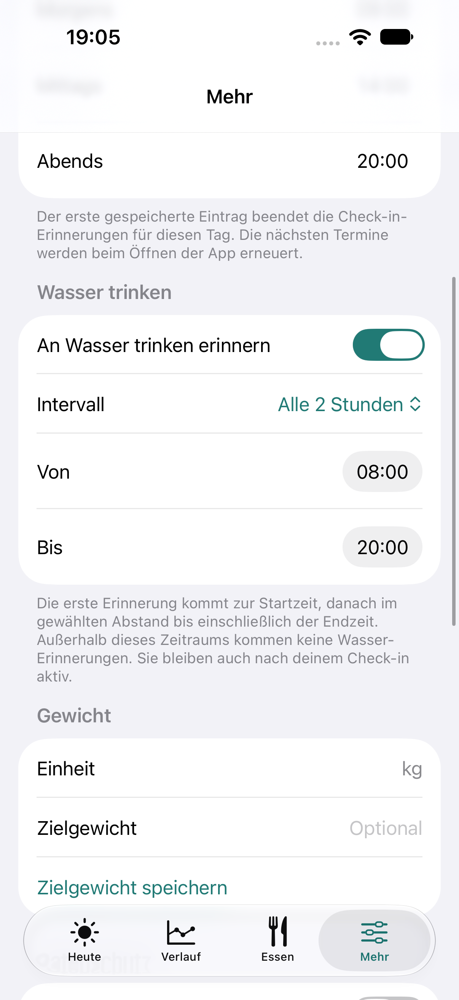

<p align="center">
  
</p>

# Daily Balance

Ein natives iPhone-Tagebuch für Gewicht, wöchentliche Körpermaße, Wohlbefinden und Mahlzeitenfotos. Deutschsprachig, mit lokaler Speicherung und ohne Registrierung oder Backend.

**Version 1.2 · iOS 17+ · SwiftUI · SwiftData · Swift Charts**

## Funktionen

| Bereich | Inhalt |
| --- | --- |
| Tageswerte | Gewicht, Wohlbefinden, Energie, Schlafqualität, Hunger, Cravings und freiwillige Notizen |
| Körpermaße | Brust, Bauch, Po sowie linker und rechter Oberschenkel; eine Messung pro Kalenderwoche |
| Verlauf | Interaktive Diagramme, Kalender und Messwertlisten; vergangene Tage bleiben lesbar und sind für Änderungen gesperrt |
| Mahlzeiten | Kamera oder Fotoimport, Kategorien, Uhrzeit und Notizen |
| Erinnerungen | Drei Check-in-Zeiten; weitere Check-in-Hinweise entfallen nach einem gespeicherten Eintrag |
| Wasser | Separater Schalter, Intervalle von 30 Minuten, 1, 2 oder 4 Stunden und eigener Tageszeitraum |
| Datenschutz | Lokale Ablage, optional Face ID oder Gerätecode, keine Analyse- oder Cloud-Dienste im App-Code |
| Export | CSV mit Tageswerten und Körpermaßen sowie JSON mit Einträgen und Mahlzeiten-Metadaten |
| Kurzbefehle | Den täglichen Check-in über einen App Intent öffnen |

Die Wochenmessung ist an ihrem Messtag korrigierbar. Ab dem folgenden Tag bleibt sie abgeschlossen. Wasser-Erinnerungen laufen unabhängig vom gespeicherten Check-in weiter.

## Einblicke

Die Bilder stammen aus Simulator-Tests und zeigen ausschließlich künstliche Testwerte.

<table>
  <tr>
    <td align="center"><strong>Heute</strong></td>
    <td align="center"><strong>Körpermaße</strong></td>
    <td align="center"><strong>Wasser-Erinnerungen</strong></td>
  </tr>
  <tr>
    <td></td>
    <td></td>
    <td></td>
  </tr>
</table>

## Schnellstart

Voraussetzungen: ein Mac mit vollständigem Xcode und einem installierten iOS-Simulator. Geprüft wurde das Projekt mit Xcode 27.1, Swift 6.4 im Swift-5-Sprachmodus und iOS-SDK 27.1. Für ein echtes iPhone muss Xcode dessen iOS-Version unterstützen.

1. Dieses Repository klonen oder als ZIP herunterladen und entpacken.
2. `DailyBalance.xcodeproj` öffnen.
3. Das Scheme **DailyBalance** und einen installierten iPhone-Simulator auswählen.
4. Mit **⌘R** starten.

Es sind keine externen Pakete, API-Schlüssel oder Backend-Einstellungen erforderlich. Das Xcode-Projekt ist vollständig enthalten; der Projektgenerator muss zum Starten nicht ausgeführt werden.

Für ein echtes iPhone im App-Target unter **Signing & Capabilities** das eigene Team einstellen und anschließend das verbundene iPhone als Ziel auswählen. Die [Installationsanleitung](Documentation/INSTALLATION.md) beschreibt alle Schritte.

Bei einem Update derselben Installation die Bundle-ID und das Signing-Team beibehalten und die App nicht deinstallieren.

## Projektstruktur

```text
DailyBalance.xcodeproj/    Xcode-Projekt und gemeinsames Scheme
DailyBalance/             SwiftUI-App, Datenmodelle, Dienste und Assets
CoreTests/                Plattformunabhängige Geschäftslogik
DailyBalanceTests/        Persistenz-, Foto-, Migrations- und Planungstests
DailyBalanceUITests/      Automatisierte Bedienungstests
Scripts/                  Projektgenerator und Prüfwerkzeuge
Documentation/            Architektur, Anleitungen und Test-Screenshots
Package.swift             Separates Paket für die Kernlogiktests
```

## Tests

In Xcode einen Simulator auswählen und **⌘U** drücken. Die UI-Tests verwenden isolierte Testverzeichnisse.

Die Kernlogik lässt sich auch ohne Simulator prüfen:

```sh
python3 Scripts/run_core_tests.py
```

Eine statische Prüfung des Projektpakets ist über `python3 Scripts/verify_project.py` möglich. `Package.swift` beschreibt nur die Kernlogik; die iPhone-App wird mit dem Xcode-Projekt gebaut.

**Prüfstand vom 16. Oktober 2026:** 56 unterschiedliche Tests bestanden, ein Hardware-Dateischutztest wurde im Simulator übersprungen. Die Zahlen berücksichtigen gezielte Wiederholungen. Simulator- und unsignierter iPhone-Build waren erfolgreich. Physisches Gerät, Kamera, Face ID und zeitgesteuerte Mitteilungszustellung sind noch praktisch zu prüfen. Details stehen im [Prüfbericht](Documentation/VALIDATION.md).

## Daten und Grenzen

Einträge und Bilder bleiben im App-Verzeichnis. Die App setzt iOS-Dateischutz und schließt das Datenverzeichnis von regulären Backups aus. Bei App-Löschung oder Geräteverlust können die Daten verloren gehen.

CSV und JSON werden nur auf Anforderung erzeugt. Sie sind unverschlüsselt, enthalten keine Bilddateien und ersetzen kein vollständiges, wiederherstellbares Backup. Die App enthält keine Importfunktion. Die Weitergabe über das Teilen-Menü bestimmt der Nutzer.

Die App dokumentiert persönliche Angaben und stellt keine medizinischen Diagnosen oder Empfehlungen bereit.

## Dokumentation

- [Installation und Signing](Documentation/INSTALLATION.md)
- [Wöchentliche Körpermaße](Documentation/KOERPERMASSE.md)
- [Wasser-Erinnerungen und abgeschlossene Tage](Documentation/WASSER-UND-VERLAUF.md)
- [Technische Dokumentation](Documentation/ARCHITEKTUR.md)
- [Prüfstand und Screenshots](Documentation/VALIDATION.md)
- [Dieses Projekt zu GitHub hochladen](Documentation/GITHUB.md)
